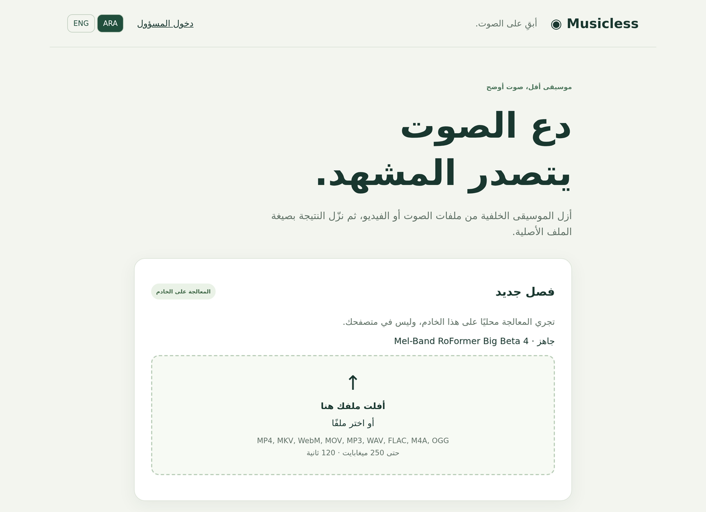

# Musicless

Musicless takes a short recording — audio or video — and gives it back without the music. Only the voice remains, in the same file type you handed it.

It runs on your own machine. Flask serves the page, and a separate worker process does the separation on your GPU with a Mel-Band RoFormer model. Nothing is uploaded anywhere, and the worker has no network access at all.



## What it does

Drop in a clip of up to 250 MiB and 120 seconds. The vocals get separated on the GPU, and you download the same file with only the voice: the video stream is copied as it was, the audio is re-encoded to the container's native codec. Files are deleted an hour after they finish.

Visitors never sign in. The admin login is only there for the settings page — GPU status, free VRAM, which model is loaded, whether a second model can be chosen.

## A few things worth knowing

- **The worker has no network.** It starts with `network_mode: none`, no ports, no Docker socket, a read-only root filesystem, plus a socket guard in Python. The checkpoint is enrolled by SHA-256 on the host, so the app can only ever load a file you put there yourself.
- **Video is never re-encoded.** H.264, HEVC, AV1, VP8/9, ProRes and MPEG-4 streams are copied, and rotation and variable-frame-rate timing travel with them.
- **Nothing degrades behind your back.** One model, one job at a time, no quiet switch to a smaller model or to CPU. When it fails you get a code: `CUDA_OOM`, `DISK_LIMIT`, `MODEL_NOT_AVAILABLE`.
- **Arabic first.** The interface opens in Arabic, right to left, and ENG / ARA in the header switches it — every page, every status, every error.
- **Small on purpose.** A queue of three files, one outstanding job per visitor, a two-gigabyte free-space floor, one hour of retention.

## Requirements

| | |
|---|---|
| Docker | Engine or Desktop, Compose v2 — the CPU override needs `!reset` |
| GPU | An NVIDIA card with room for a 1.57 GB checkpoint, plus the host driver and the [NVIDIA Container Toolkit](https://docs.nvidia.com/datacenter/cloud-native/container-toolkit/latest/install-guide.html) |
| Disk | About 1.6 GB for the model, 2 GiB free-space floor, 1.5 GiB per job |
| Model | `melband_roformer_big_beta4.ckpt` and its `.yaml` — you supply both |

Put the data directory on a local Linux filesystem. SMB, NFS and `/mnt/c` will bite you: SQLite and the job workspaces want real local semantics. On a VM, GPU passthrough and the driver inside the guest are your problem to solve first.

## Install

```bash
git clone https://github.com/a-alomairah/musicless.git && cd musicless
docker build --target web -t musicless-web .
cp .env.example .env
mkdir -p models "$HOME/musicless-data"
sudo chown 10001:10001 "$HOME/musicless-data"
docker run --rm -it --network none musicless-web python -m musicless.manage credentials
```

That last command prints a password hash and a session secret. Put both into `.env`, keep the single quotes around the hash — its `$` characters have to stay literal — and set `DATA_DIR` to the absolute path of `$HOME/musicless-data`. `chmod 600 .env` afterwards, since it now holds real credentials.

Drop the two model files into `models/`:

```text
models/melband_roformer_big_beta4.ckpt
models/config_melbandroformer_big_beta4.yaml
```

Or leave them wherever they already are and point `MODELS_DIR` at that directory — the checkpoint is 1.57 GB and copying it around is pointless. The YAML has to be the one that matches the checkpoint, taken from the Audio Separator cache that produced it. Filenames matter; a missing YAML is an error rather than a download. The mapping I use was checked against the 0.47.0 wheel's [`audio_separator/models.json`](https://github.com/nomadkaraoke/python-audio-separator/blob/v0.47.0/audio_separator/models.json).

Record the checksums once, then start:

```bash
docker run --rm --network none --user "$(id -u):$(id -g)" \
  -v "$PWD/models:/models:ro" -v "$PWD/config:/config" \
  musicless-web python -m musicless.manage enroll big-beta-4 \
  --models /models --registry /config/models.json
docker compose build
docker compose up -d
```

Open <http://localhost:8000>. The worker hashes the full checkpoint the first time it starts, so the page may report the model as unavailable for a minute or two. After that, drop a file in.

## Configuration

Everything lives in `.env`, and `.env.example` documents the defaults.

| Variable | Default | Meaning |
|---|---|---|
| `BIND_ADDRESS` / `PORT` | `127.0.0.1` / `8000` | Where the web container publishes |
| `DATA_DIR` | — | Absolute host path for the queue and job directories |
| `MODELS_DIR` / `CONFIG_DIR` | `./models` / `./config` | Model files and registry, mounted read-only |
| `COOKIE_SECURE` | `false` | Set it `true` once you are behind HTTPS |
| `MAX_UPLOAD_MB` | `250` | Largest accepted file |
| `MAX_DURATION_SECONDS` | `120` | Longest accepted clip |
| `MAX_QUEUED_JOBS` | `3` | Uploading plus queued jobs, globally |
| `MAX_OUTSTANDING_PER_USER` | `1` | Outstanding jobs per visitor or admin |
| `JOB_TIMEOUT_SECONDS` | `900` | Hard deadline for processing |
| `RETENTION_SECONDS` | `3600` | How long a finished file survives |
| `DISK_FLOOR_MB` | `2048` | Free space below which uploads stop |
| `JOB_STORAGE_MB` | `1536` | Working space reserved per job |
| `ALLOW_CPU` | `false` | Run without a GPU — slow, often past the deadline |
| `WORKER_MEMORY_LIMIT` / `WORKER_CPUS` | `16g` / `4` | Container limits for the worker |

One job at a time is deliberate: the model is sized for a single card, and running two would just make both slower and risk an out-of-memory. Visitors get a private browser session and can see, cancel and download only their own files. Clear your cookies and you lose access to a guest result — that is how the ownership model works, not a bug. There is no registration.

Uploads are streamed, not buffered into a multipart form, and the API takes nothing but `filename`, `model_id` and a CSRF header. Stale uploads expire after 20 idle minutes, stale queue entries after an hour, old metadata after a day. A worker restart marks whatever it was processing as failed rather than retrying it behind your back.

## Files it accepts

| Extension | Container | Audio out | Video |
|---|---|---|---|
| `.mp4` | ISO BMFF/MP4, not QuickTime | AAC | Copies H.264, HEVC, AV1, MPEG-4 |
| `.mov` | QuickTime, `qt` brand | AAC | Copies H.264, HEVC, ProRes, MPEG-4 |
| `.mkv` | Matroska | AAC | Copies H.264, HEVC, AV1, VP8/9, MPEG-4/2, ProRes |
| `.webm` | WebM | Opus | Copies VP8/9, AV1 |
| `.mp3` | MP3 | MP3 | — |
| `.wav` | WAV | PCM 16-bit | — |
| `.flac` | FLAC | FLAC | — |
| `.m4a` | ISO BMFF audio | AAC | — |
| `.ogg` | Ogg audio | Vorbis | — |

Audio in: AAC, MP3, Opus, Vorbis, FLAC, ALAC, AC3/EAC3 and the usual PCM variants, mono or stereo, 8–96 kHz. Video up to 3840×2160.

One audio track, at most one video track, and nothing else — no subtitles, attachments, cover art or data streams. If a file is rejected, export a simpler version of it; refusing the file is better than silently dropping an alternate language track. Tags and chapters are stripped on purpose. Audio is aligned to the timeline, padded to the declared duration, and the finished file is fully decoded before you get a link, so what you download is known to play. Rotated or oddly timestamped sources are the one case I would still try by hand before trusting the result.

Separation runs on a lossless 44.1 kHz float WAV and asks Audio Separator for the vocals stem only. Arabic speech and singing get the model's normal treatment; the quality depends on the model, and there is no special handling for any language.

## Behind a reverse proxy

Nothing about your proxy gets touched. Point it at port 8000, set `COOKIE_SECURE=true`, and keep the loopback binding for everything else. For nginx, roughly:

```nginx
client_max_body_size 250m;
client_body_timeout 300s;
proxy_connect_timeout 10s;
proxy_send_timeout 300s;
proxy_read_timeout 300s;
proxy_request_buffering off;
proxy_buffering off;
```

With buffering on, the proxy swallows the upload before the app sees it; off keeps the backpressure. The app ignores `X-Forwarded-*` headers entirely and has no `ProxyFix`, so there is no trusted-range to configure — but the login rate limit keys off the immediate peer, which means one bucket for everyone behind the proxy.

If the proxy runs in another container, put **web only** on that private network and stop publishing the port. Never attach the worker to anything. Port 8000 does not belong on the internet.

## Adding another model

Stop the worker, get the files from somewhere you trust, and add an entry to `config/models.json`: a unique lowercase `id`, a name, plain `.ckpt` and `.yaml` filenames, an honest `min_bytes`, and empty hashes. Run the same `enroll` command with the new id, restart, run the GPU test for it, then choose it in settings. The adapter speaks MDXC/RoFormer; a different architecture needs a real adapter and its own tests. The registry is edited on the host by you — there is no upload path for models.

## When something goes wrong

| What you see | What to look at |
|---|---|
| `MODEL_NOT_AVAILABLE` | Filenames, symlinks, permissions for UID 10001, file size, enrolled hashes, YAML structure |
| Worker offline or starting | `docker compose ps`, worker logs, a writable local data directory, the first hashing pass |
| `CUDA_UNAVAILABLE` / `CUDA_OOM` | Driver and toolkit on the host, passthrough on a VM, free VRAM. Without `ALLOW_CPU=true` there is no fallback |
| `MEDIA_FAILED` / `PROCESSING_FAILED` | The source file against the table above, or the dependencies. The synthetic tests tell the two apart; raw FFmpeg errors stay in the worker log |
| `QUEUE_FULL` / `USER_LIMIT` | An outstanding job from the same session, or three in the queue already |
| `DISK_SPACE` / `DISK_LIMIT` | Free space, or the floor and per-job budget you set |
| 413, or an upload that hangs | Proxy limits and buffering, and how long the model preflight takes on your disk |
| Login loops | `COOKIE_SECURE` wrong for the scheme, or a `$` in the hash that got eaten by your shell |

The floor and the per-job budget are admission checks, not filesystem quotas — a burst can overshoot between supervisor passes. Use a bounded filesystem if you want a hard cap. Run one worker per data volume: a second one will fight the first over the same SQLite queue.

## Development

The test suite uses synthetic fixtures generated in temp directories. It never reads your media or your checkpoint.

```bash
docker build --target test -t musicless-test .
docker run --rm --network none -e ASSERT_NETWORK_NONE=1 musicless-test
```

Or locally, with Python 3.12 and FFmpeg/FFprobe on PATH:

```bash
python -m pip install -r requirements-test.txt
python -m pytest -q
```

Set `FFMPEG` and `FFPROBE` if the binaries live outside PATH. The lock files pin the Linux dependency sets, so a local venv and the image agree.

For a real GPU run — the build has network access, the runtime does not:

```bash
docker build --target gpu-test -t musicless-gpu-test .
docker run --rm --gpus all --network none --read-only \
  --tmpfs /tmp:rw,size=1g,mode=1777 \
  -e DATA_DIR=/tmp/data -e MODEL_REGISTRY=/config/models.json -e MODELS_DIR=/models \
  -e RUN_GPU_TESTS=1 -e ASSERT_NETWORK_NONE=1 \
  -v "$PWD/config:/config:ro" -v "$PWD/models:/models:ro" \
  musicless-gpu-test python -m pytest -q -m 'gpu or container' -p no:cacheprovider
```

The code is small enough to read in an afternoon:

- `musicless/web.py` — routes, streamed uploads, sessions
- `musicless/worker.py` — the queue loop and its supervision
- `musicless/media.py` — validation and the FFmpeg calls
- `musicless/db.py` — SQLite queue and job records
- `musicless/static/app.js` — upload progress and polling
- `config/models.json` — what you have enrolled
- `tests/` — the suite, with its synthetic fixtures

`.env`, the checkpoint and its YAML, media files, runtime data and scratch downloads stay out of Git. `.dockerignore` is the build allowlist, and it is narrower than `.gitignore` on purpose.

## Tested on

An NVIDIA GeForce GTX 1060 6 GB, driver 580.178.04, CUDA runtime 12.6 through the `+cu126` PyTorch wheels — Torch, Torchaudio 2.11.0 and Torchvision 0.26.0 — Python 3.12.8 on `python:3.12.8-slim-bookworm`, and Audio Separator 0.47.0.

On that card `torch.cuda.is_available()` is `True`, roughly 6.1 GB of VRAM is reported, and the enrolled checkpoint passes its integrity check. I have not benchmarked job time there; the 900-second deadline is the guard that matters. More VRAM just gives the 1.57 GB model more room.

Development happens on Windows/WSL2 with FFmpeg 9.0.2, where the suite ends at **50 passed, 2 skipped** — the two skips are real GPU inference and the Docker network-namespace check, neither of which exists on that machine. A GPU being present is not proof that inference works, so run the GPU test above against your own media before trusting a result from another card.

## Privacy

`/privacy`, in both languages, lays out what is processed, what is stored, how long it lives, what the cookies do, and where application-managed deletion stops. Those numbers come from the web configuration, so keep web and worker consistent if you run them apart. Log and backup retention are yours. Nothing leaves the host.

## License

GPL-2.0, see [LICENSE](LICENSE). The dependencies and the model keep their own licences; the checkpoint is not in this repo.
